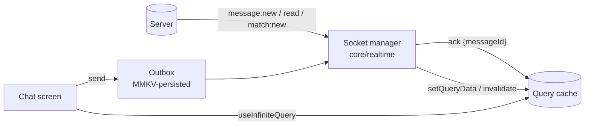
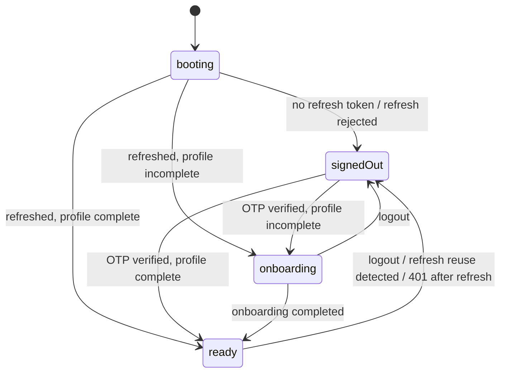
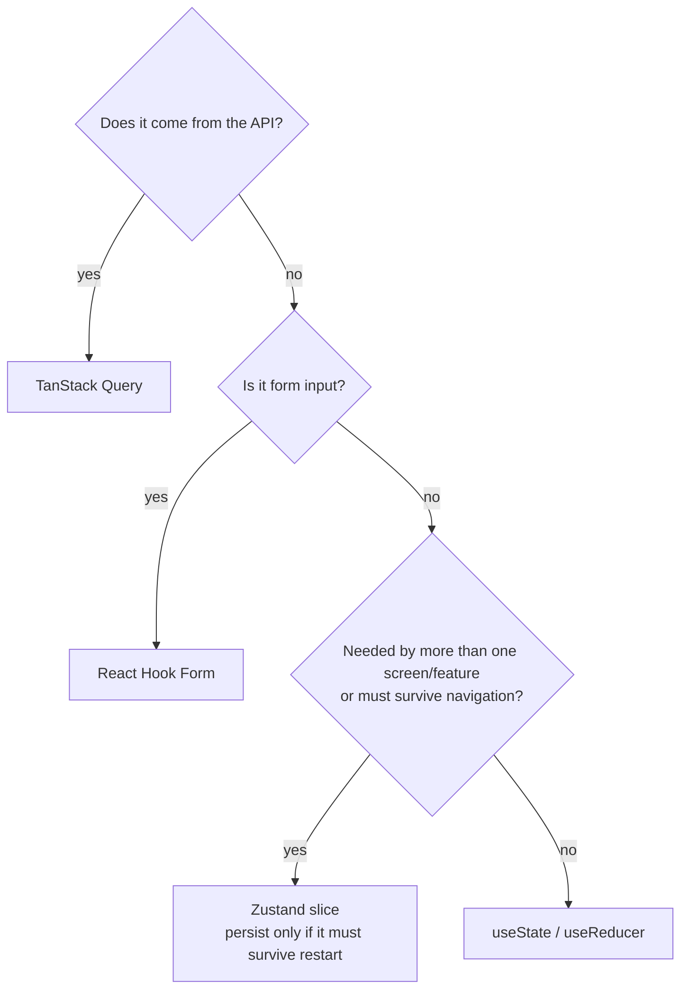

# 02 — State Management

Status: Draft v0.1 · Related: [ADR-0003](adr/0003-state-tanstack-query-zustand.md)

The single most important rule: **put each piece of state in the one place that fits its nature, and never duplicate it.**

## 1. The five kinds of state

| Kind | Examples | Tool | Source of truth |
|---|---|---|---|
| **Server state** | profile, matches, conversations, messages | **TanStack Query** | The backend (Query is a cache) |
| **Client/global state** | auth session status, swipe-deck queue, onboarding progress, UI prefs | **Zustand** (small slices) | The client |
| **Form state** | OTP input, profile edit, report form | **React Hook Form + Zod** | The form |
| **Local UI state** | modal open, text-field focus, animation values | `useState` / `useReducer` / Reanimated shared values | The component |
| **Persisted state** | tokens, onboarding draft, outbox of unsent messages | **expo-secure-store** (secrets) · **MMKV** (non-sensitive) | Disk |

**Never copy server data into Zustand.** If it came from the API, it lives in the Query cache and components read it through a hook.

## 2. Server state (TanStack Query)

- One `QueryClient` in `core/providers`. Defaults: `staleTime` 30–60 s for lists, `retry` 2 with exponential backoff (never retry 4xx except 429), `gcTime` 5–10 min.
- **Query key factories** per feature (`matchKeys.list()`, `chatKeys.messages(conversationId)`) — no string literals scattered in components.
- Generated hooks/functions from the OpenAPI client are wrapped by **feature hooks** (`useMatches()`); components use only those.
- **Mutations** declare their invalidation/optimistic update in the hook, not at the call site.
- **Lists:** `useInfiniteQuery` with cursor pagination (`nextCursor`) for matches and messages.
- **Offline:** `onlineManager` wired to NetInfo; mutations that must survive reconnects use persisted/paused mutations (outbox, §5). Optional cache persistence (`persistQueryClient` with an MMKV persister) for chat list and matches only — never for auth data.
- **Error normalization:** the http layer maps problem+json to `AppError`; `useQuery` `error` is always `AppError`.

## 3. Client state (Zustand)

Small, feature-owned slices, exported only through hooks/selectors:

| Store | Owner | Holds |
|---|---|---|
| `useAuthStore` | `core/auth` | `status` (`booting \| signedOut \| onboarding \| ready`), `user` summary, `sessionId` — **tokens are not in the store** (kept in secure storage inside the session manager) |
| `useDeckStore` | `features/discovery` | Local swipe queue, current index, pending (unsent) swipe actions |
| `useOnboardingStore` | `features/onboarding` | Step progress + draft answers (persisted to MMKV so a killed app resumes) |
| `useUiStore` | `shared` | Toasts, global sheets, network banner |

Rules:
- Always consume with **selectors** (`useDeckStore(s => s.index)`), never the whole store, to avoid re-renders.
- Actions live in the store; async work lives in hooks/services that call store actions.
- Stores don't import from each other; coordination happens in hooks.
- Persist with the `persist` middleware + MMKV storage only where noted.

## 4. Form state

- **React Hook Form** with `zodResolver`. Schemas live in `features/*/schemas`; where the backend defines the same rule (OTP length, bio max length) use the **generated Zod schema** so client and server can't disagree.
- Show field errors from validation and map server `errors[].path` (RFC 7807 body) back onto fields with `setError`.
- Submit handlers call a feature mutation hook; the screen only reacts to `isPending` / `error`.

## 5. Realtime and chat

**Sockets write into the Query cache; the UI reads only from the cache.**

- **Optimistic send:** the UI inserts a local message `{clientMsgId, status:'sending'}` into the cache; on `ack` it is reconciled to the server id (`status:'sent'`); on failure `status:'failed'` with a retry action. Retries reuse the same `clientMsgId` (the server de-duplicates).
- **Outbox:** unsent messages persist in MMKV so a restart or offline period doesn't lose them; flushed on reconnect in order.
- **Gap fill:** on reconnect, fetch `GET /conversations/:id/messages?after=<lastId>` and merge by `messageId` (sockets are at-least-once; always de-duplicate).
- **Unread/badges:** derived from the conversations query (`unreadCount`), updated by socket events and read receipts — no separate counter state.
- Typing/presence are **ephemeral** local state (Zustand/`useRef`), never in Query.

## 6. Swipe deck specifics

- The deck is **client state seeded by server data**: `GET /discovery/deck` → append to `useDeckStore`; prefetch the next batch when ≤ 5 cards remain.
- A swipe is **optimistic and fire-and-forget**: advance the card immediately, send `POST /swipes` with a `requestId`; on failure queue for retry (idempotent). A match response triggers the match modal and invalidates `matches` and `conversations`.
- Undo is not in v1 (would need a server contract change).
- Photos for the next 2–3 cards are prefetched with `expo-image`.

## 7. Auth state machine

Owned by `core/auth`. The **root layout** subscribes to it and renders the right route group; individual screens do not redirect.

- `booting` keeps the native splash visible (`expo-splash-screen`) until the state resolves — **no fixed timers** (the Flutter prototype waited a hard-coded 3 s).
- Token handling (details in [API client](05-api-client-and-realtime.md)): refresh token in secure store; access token in memory; a single in-flight refresh promise shared by concurrent 401s; refresh failure → `signedOut`.
- Route protection uses Expo Router's guarded routes / `Redirect` in the layout based on `status`.

## 8. Where to put new state — decision guide

## 9. Anti-patterns (rejected in review)

- Mirroring query data into `useState`/Zustand "to make it easier"
- `useEffect` to fetch data (use Query) or to sync derived state (compute it)
- Storing tokens in Zustand, AsyncStorage or MMKV
- Components calling `fetch`/generated functions directly
- Global store subscriptions without selectors
- Business rules inside components instead of hooks
