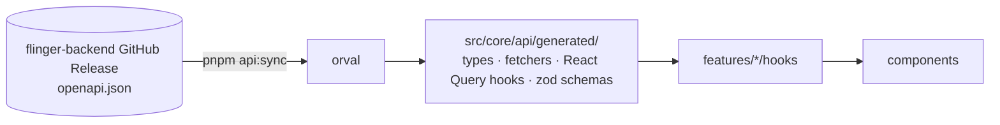

# 05 — API Client, Auth Plumbing, Realtime & Push

Status: Draft v0.1 · Related: [ADR-0005](adr/0005-generated-api-client.md) · Backend contract: `flinger-backend/docs/04-api-and-contracts.md`

## 1. Generated API client

- **Tool:** `orval` (OpenAPI → TypeScript types, typed fetchers, React Query hooks, Zod schemas) with a custom **mutator** so all requests go through our http client (auth header, error normalization, version headers).
- **Command:** `pnpm api:sync [--tag vX.Y.Z]` downloads `openapi.json` from the backend release, writes `api/openapi.lock` (tag + checksum), regenerates `src/core/api/generated/`. **Generated code is committed** (reviewable diffs) and never hand-edited.
- **CI drift check:** regenerate from the locked spec and `git diff --exit-code`; fails if the committed client is stale.
- **Rule:** no hand-written calls for endpoints in the spec; components never import `generated/` ([architecture](01-architecture.md)).

## 2. HTTP layer (`core/api`)

| Concern | Behavior |
|---|---|
| Base URL | From typed config (`EXPO_PUBLIC_API_URL`) per build profile |
| Headers | `Authorization: Bearer <access>`, `X-App-Version`, `X-Platform`, `X-Device-Id` (stable per install, kept in secure storage), `Accept-Language` |
| Timeouts | 10 s default; uploads use their own longer timeout |
| Error normalization | RFC 7807 body → `AppError { code, status, message, fieldErrors?, requestId, retryable }`; network failures → `AppError{ code:'NETWORK' , retryable:true }` |
| Retries | Handled by TanStack Query policy (not the http layer); 4xx never retried except `429` honoring `Retry-After` |
| Update gate | `426` with `code: APP_UPDATE_REQUIRED` → set a global flag → blocking "Update required" screen with store link |
| Observability | Request id from error body attached to Sentry breadcrumbs |

## 3. Session manager (`core/auth`)

Single module owning credentials; **nothing else touches tokens**.

- **Storage:** refresh token in `expo-secure-store` (Keychain/Keystore, `WHEN_UNLOCKED_THIS_DEVICE_ONLY` where UX allows); access token in memory only; `deviceId` in secure store.
- **Attach:** http layer asks the session manager for the current access token per request.
- **Refresh:** on `401` (or token within ~30 s of expiry) the manager runs **one** refresh request; concurrent callers await the same promise; the original request is replayed once. Refresh rotates the refresh token — persist the new one **before** resolving.
- **Failure:** refresh `401/403` (revoked, reuse detected, expired) → clear storage, set auth state `signedOut`, reset Query cache and stores, disconnect socket.
- **Logout:** call `POST /auth/logout` (best effort), then clear local state regardless of the response.
- **Cold start:** `booting` → read refresh token → refresh → fetch `/me` → decide `onboarding` vs `ready` ([state machine](02-state-management.md#7-auth-state-machine)).

## 4. Error → UI mapping

- Map `AppError.code` to i18n keys: `errors.OTP_INVALID`, `errors.OTP_EXPIRED`, `errors.RATE_LIMITED`, `errors.LIKE_LIMIT_REACHED`, …; unknown codes fall back to `errors.generic`.
- Field errors from `errors[]` map to form fields via `setError`.
- Retryable errors show an inline retry; non-retryable show a message + next action.
- **Never branch on message text**; only on `code`.

## 5. Realtime (`core/realtime`)

- **Socket.IO client**, WebSocket transport only (matches backend [ADR-0008](https://github.com/singh3abhi/flinger-backend/blob/main/docs/adr/0008-realtime-socketio-redis.md)), namespace `/chat`.
- **Lifecycle:** connect when `auth.status === 'ready'` and app is foregrounded; disconnect on background (after a short grace), logout, or update-required. Handshake sends the current access token; on `connect_error` with an auth error → refresh then reconnect (exponential backoff with jitter, capped).
- **Events in:** `message:new`, `message:ack`, `read`, `typing`, `presence`, `match:new` → handlers write to the Query cache ([state doc §5](02-state-management.md#5-realtime-and-chat)).
- **Events out:** `message:send`, `read`, `typing` (throttled ~1 per 3 s).
- **Reconnect:** after reconnect, gap-fill active conversations via REST (`?after=<lastId>`) and refetch the conversation list.
- **Typing/presence** stay as ephemeral local state.

## 6. Push notifications (`core/notifications`)

- **Permission:** requested at the moment of value with a primer screen ([migration U2](04-flutter-migration.md)); persist the user's "not now" to avoid nagging.
- **Token:** obtain the native device token (FCM/APNs through Firebase per [backend ADR-0009](https://github.com/singh3abhi/flinger-backend/blob/main/docs/adr/0009-push-via-fcm.md)); upsert via `PUT /devices/:id/push-token` on app start/login/token refresh; deregister on logout.
- **Handling:** foreground → in-app toast + cache update (no OS banner if the conversation is open); background tap → deep link to `chat/[conversationId]` or the matches tab.
- **Payload contract:** ids only (`type`, `conversationId`/`matchId`); the app fetches content — no message text on lock screens by default.
- **Android channels:** `matches`, `messages` (importance default), created at startup.

## 7. Media

- **Upload:** `POST /me/photos` → presigned URL → direct `PUT` to S3 with the right `Content-Type`; show per-photo progress; client-side resize/compress first (`expo-image-manipulator`, max ~1600 px long edge, JPEG/HEIC → JPEG) to save data and moderation time.
- **States:** `pending` (shown to the owner with a "reviewing" badge) → `approved` | `rejected` (prompt to replace). Only `approved` photos appear to others.
- **Display:** `expo-image` with blurhash placeholders and disk caching; CDN URLs from the API.
- **Permissions:** `expo-image-picker` uses system pickers (limited-library friendly); camera permission only if camera capture is offered.

## 8. Config & feature flags

- `GET /v1/config` on boot (and foreground, throttled): `minSupportedVersion`, feature flags, limits (bio length, photo count, daily likes). Cached; failure falls back to last known/defaults.
- Local `core/config` merges build-time env with remote config; features read flags via a `useFlag('chat.images')` hook.

## 9. Security notes (client)

- Anything in the bundle is public: no API secrets, no signing keys.
- `EXPO_PUBLIC_*` vars are visible to users — only URLs and public identifiers.
- Consider certificate pinning only if a threat model demands it (adds operational risk); not planned for v1.
- Screenshots/screen-recording protection for chat is **not** planned (platform-limited, low value); note for later if requested.
- Clear Query cache + MMKV on logout/account deletion.
