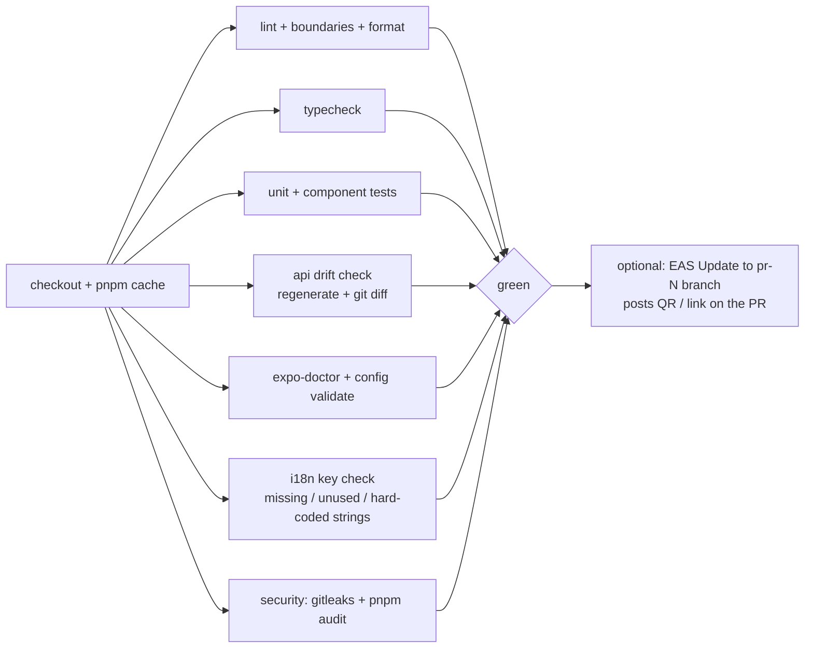

# 06 — CI/CD & Releases (Mobile)

Status: Draft v0.1 · Tooling: GitHub Actions + **EAS** (Build, Submit, Update) · Backend pipeline: `flinger-backend/docs/07-cicd.md`

## 1. Principles

1. **Trunk-based**, small PRs, `main` always shippable.
2. **Native builds are slow and rare; JS updates are fast and common.** Use EAS Update (OTA) for JS/asset changes, EAS Build only when native code/config changes.
3. **Three build profiles → three environments**, no config edited by hand per build.
4. **Same commit, promoted:** staging and production binaries come from the same codebase; env differences come only from the profile.
5. **No secrets in the repo or the bundle.** Signing credentials live in EAS; CI authenticates with an `EXPO_TOKEN`.

## 2. Environments & EAS profiles

| Profile (`eas.json`) | Purpose | Distribution | API | Update channel | Notes |
|---|---|---|---|---|---|
| `development` | Day-to-day dev | Internal, **dev client** (simulator + device) | local / staging | `development` | `developmentClient: true` |
| `staging` | QA / beta testers | Internal (ad-hoc/TestFlight internal, Play internal) | `staging` API | `staging` | Release-like build |
| `production` | Store | App Store / Play | `prod` API | `production` | Auto-increment build number (remote) |

Env values per profile come from EAS environment variables (`EXPO_PUBLIC_API_URL`, Sentry DSN, etc.); `app.config.ts` reads them. Firebase files (`google-services.json`, `GoogleService-Info.plist`) are **EAS file secrets**, per environment.

## 3. Pipelines

### 3.1 `pr.yml` — every pull request



| Job | Enforces |
|---|---|
| `lint` | ESLint (incl. boundary rules, no hex colors / raw sizes in features, no `console.log`), Prettier |
| `typecheck` | `tsc --noEmit` strict |
| `test` | Jest + React Native Testing Library; coverage reported |
| `api-drift` | `pnpm api:sync --from-lock` then `git diff --exit-code` |
| `expo-doctor` | Dependency/SDK compatibility, config validity |
| `i18n` | Every `t('key')` exists in `en`; no unused keys; no hard-coded user strings (lint rule) |
| `security` | `gitleaks`, `pnpm audit --prod` (high+) |
| `pr-preview` *(label `preview`)* | `eas update --branch pr-<n>` so a dev-client build can load the PR's JS |

### 3.2 `main.yml` — merge to `main`

1. Re-run fast checks.
2. **`eas update --channel staging`** (OTA to staging builds). Skipped automatically when native fingerprint changed (job fails with a message → build required).
3. **Native fingerprint check** (`@expo/fingerprint`): if native deps/config changed since the last staging build, trigger **`eas build --profile staging`** (iOS + Android, non-interactive) and distribute to internal testers.
4. Post summary (update group id, build links) to the PR/commit.

### 3.3 `release.yml` — tag `v*` (or manual dispatch)

1. `eas build --profile production --platform all --auto-submit` → **EAS Submit** to **TestFlight** and **Google Play internal testing**.
2. Create GitHub Release with changelog.
3. **Human gate:** promote in the stores (TestFlight → App Store review; Play internal → closed → production with **staged rollout** 5 % → 20 % → 50 % → 100 %).
4. Upload source maps to Sentry; tag the release (`app@version+build`).

### 3.4 `hotfix-ota.yml` — manual dispatch

`eas update --channel production` with a message, for **JS-only** fixes. Guard rails: only allowed if the fingerprint equals the one of the live production build; requires environment approval; post-update crash-rate check in Sentry for 30 min.

### 3.5 Housekeeping
Dependabot (npm, GitHub Actions) weekly; Expo SDK upgrades handled as dedicated PRs (one SDK per PR, `expo-doctor` + e2e smoke).

## 4. Versioning & compatibility

- **App version** (`1.4.0`) is semantic and set in `app.config.ts`; **build number** auto-incremented remotely by EAS.
- **`runtimeVersion` policy:** `fingerprint` (an OTA only reaches binaries with a compatible native layer) — prevents shipping JS that needs native code the installed app lacks.
- **API compatibility:** each app version works with the backend's additive-only `/v1` contract; the backend can raise `minSupportedVersion` and respond `426`, which shows the blocking "Update required" screen ([API & realtime §2](05-api-client-and-realtime.md)).
- **Rollback:** OTA — republish the previous update group to the channel (`eas update:republish`); binary — halt the staged rollout in the store and ship a fix forward.

## 5. Store & account prerequisites (do early — they have lead time)

| Item | Notes |
|---|---|
| Apple Developer Program | Paid annual membership; required for TestFlight/App Store, push (APNs key) |
| Google Play Console | One-time registration fee; new personal accounts may have testing requirements before production access — check current Play policy early |
| Bundle identifiers | Permanent; choose before first build (prototype ids are placeholders) |
| App icon, splash, screenshots, store copy | Brand assets pending (design decision D5) |
| Privacy policy + terms URLs | Required by both stores; also needed for the in-app links that currently do nothing |
| Data-safety / privacy nutrition labels | Derive from the backend's data inventory |
| Age rating & UGC disclosure | Dating/UGC → report/block/moderation must be demoable (backend phase P7) |
| Sign in with Apple | Required if any other third-party login is offered |
| Sentry, Firebase projects | Per environment where practical |

## 6. Release train (post-launch)

- **Weekly** JS releases via OTA to staging → production after verification.
- **Bi-weekly/monthly** native releases (store review) as needed; always bundle SDK/native upgrades there.
- Release checklist template in `.github/ISSUE_TEMPLATE/release.md`: smoke test list, flags, rollout %, rollback plan, metrics to watch (crash-free rate, sign-in success, API error rate).

## 7. Planned files

```
.github/
├── workflows/{pr,main,release,hotfix-ota}.yml
├── dependabot.yml
├── CODEOWNERS
├── pull_request_template.md
└── ISSUE_TEMPLATE/release.md
eas.json
app.config.ts
```
Created in mobile roadmap **M1**.
