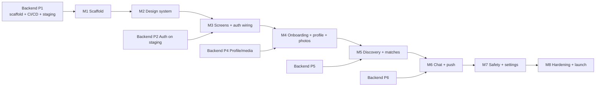

# 08 — Mobile Roadmap

Status: Draft v0.1 · Sizing: **S** ≈ days, **M** ≈ 1–2 weeks, **L** ≈ 2+ weeks (relative, not promises). Sequenced against the master plan in `flinger-backend/docs/09-roadmap.md` (phases **P0–P8**).

## Mapping to backend phases

M1–M2 need **no backend** (they run on mocks/MSW), so they can start immediately after the repo is created.

## Milestones & exit criteria

### M1 — Scaffold (S–M)
- Expo + TypeScript strict + Expo Router; dev client builds; path aliases
- Tokens, NativeWind preset, Inter fonts (lowercase path), assets copied, i18n (en + hi scaffolding) with ARB→JSON script
- Lint (boundaries, hex/size/string rules), Jest + RNTL + MSW, Sentry stub
- EAS profiles (`development`/`staging`/`production`), GitHub Actions `pr.yml`, `main.yml`; permanent bundle ids decided (ADR)
- OpenAPI codegen wired (`pnpm api:sync`) against the first backend spec (or a checked-in placeholder until P1 ships it)

**Exit:** dev-client build runs on iOS + Android; CI green; an empty app shell navigates between route groups; reference Flutter screenshots captured in `docs/reference/flutter/`.

### M2 — Design system (M)
- `Button`, `IconButton`, `TextField`, `Text`, `Screen`, `Spinner/LoadingDots`, `LoaderOverlay`, dialog/sheet per [design system](03-design-system.md)
- Component gallery route; accessibility checks (labels, 44 pt targets, contrast decision D1)
- Component tests for all variants/states

**Exit:** every component renders to spec against Flutter references; D1–D4 decisions recorded.

### M3 — Screens + auth wiring (M)
- Splash (native + boot logic), landing (video/poster), **phone-or-email OTP flow** (identify → verify with resend countdown; backend ADR-0006), permission primer screens (real requests deferred to the moment of need)
- Session manager (secure storage, refresh dedupe), auth state machine in root layout, error mapping, update-required gate
- Wired to **staging auth** once backend P2 is live

**Exit:** real sign-in/out on a physical device against staging; parity checklist ticked for each ported screen; first EAS preview/staging build distributed.

### M4 — Onboarding, profile & photos (L)
- **Port the 11-step questionnaire** already built in Flutter (name + 18+ birthday, gender, who to meet, intentions, height, values, kids/family, religion/politics, causes, photos) with stable option ids; add the **3 prompts** step if decision D2 = yes
- Photos: **min 4 / max 6**, picker + crop, upload with progress and moderation states (`pending/approved/rejected`)
- Onboarding progress persisted and resumable (MMKV draft + server draft once verified); profile edit screen (Profile tab is a stub today)

**Exit:** a new user completes onboarding with approved photos on a real device; killed-app resume works.

### M5 — Discovery & matches (L)
- Swipe deck (rebuild of the Flutter `swipe_cards` fork with Reanimated + Gesture Handler; like/pass), profile card (verified badge, About, Looking for, Values, Family, Lifestyle, Causes), optimistic swipes with retry, match modal, matches list, Liked You list, real Discover tab; **25 likes/day** UX
- Like targeting (photo/prompt + comment) per decision D1
- Empty/expand-distance states; daily-limit UX

**Exit:** two test accounts match on devices; deck holds 60 fps on a mid-tier Android; deck/queue unit tests green.

### M6 — Chat & push (L)
- Conversation list, chat screen (FlashList inverted, optimistic send, outbox, read receipts, typing), socket manager, gap fill
- Push: permission primer after first match, token registration, foreground/background handling, deep links

**Exit:** realtime chat between two phones; offline recipient receives push and deep-links into the thread; reconnect test passes.

### M7 — Safety & settings (M)
- Block/report (profile + chat), unmatch, pause, delete account, data export request, legal links (real URLs), community-guidelines screen, notification preferences

**Exit:** all store-required safety flows demoable; Maestro flows 1–5 pass on staging.

### M8 — Hardening & launch (L)
- Performance pass against [budgets](07-testing-and-quality.md), a11y audit (screen reader, 130 % fonts), offline/poor-network pass, crash-free target
- Store assets, listings, privacy labels; TestFlight + Play closed beta; staged rollout plan; runbook for OTA hotfix & rollback

**Exit:** store approvals; production release at 5 % staged rollout with dashboards watched.

## Parallelization notes

- M1–M2 run in parallel with backend P1–P2.
- Backend P4/P5/P6 deliver endpoints ahead of each mobile milestone; until then the app runs against **MSW mocks generated from the OpenAPI spec**, so mobile is never blocked.
- Each milestone ends with an **EAS staging build** for the owner to try.

## Risks specific to mobile

| Risk | Mitigation |
|---|---|
| Swipe-deck performance on low-end Android | Reanimated worklets, limit rendered cards to 2–3, image downscaling/prefetch, early profiling in M5 |
| Native-module/SDK churn (Expo upgrades) | Pin SDK; upgrade in dedicated PRs with `expo-doctor` + e2e smoke |
| App Store review (dating/UGC, login) | Safety features complete before submission; Sign in with Apple if other social logins; explain moderation in review notes |
| OTA misuse shipping incompatible JS | `runtimeVersion` = fingerprint policy; hotfix workflow guardrails |
| Contract drift with backend | Drift check in CI + `oasdiff` on the backend + pinned `openapi.lock` |
| Placeholder identifiers/branding reach the store | Decisions D5 and bundle-id ADR are M1 exit items |
